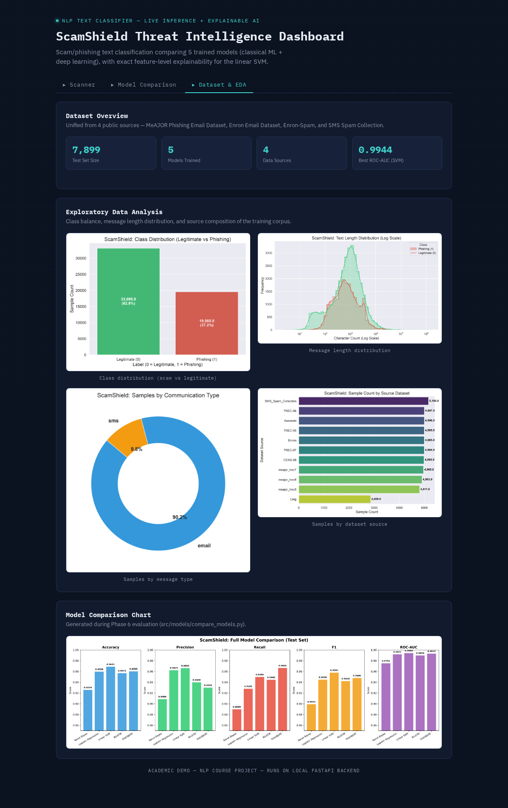
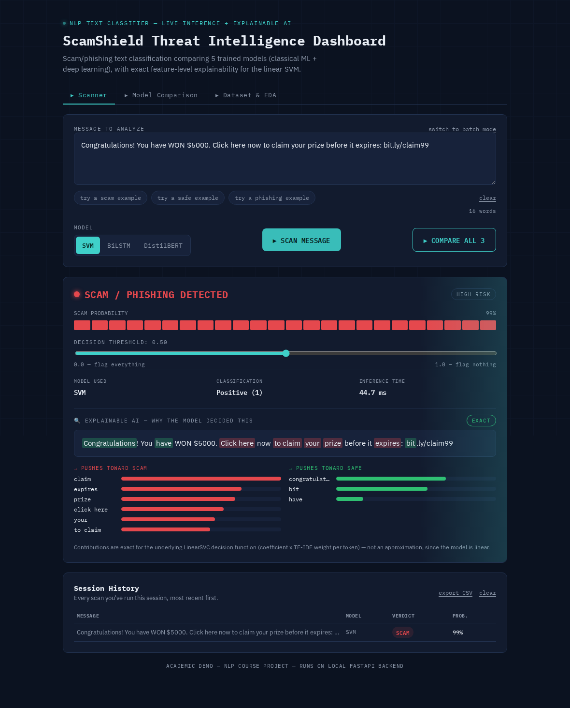
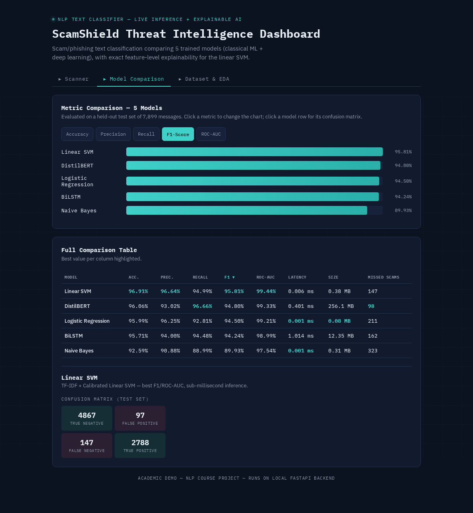

<div align="center">

# 🛡️ ScamShield NLP

### Scam & Phishing Text Detection — Classical ML vs. Deep Learning, Head to Head

*A comparative NLP study classifying SMS/email messages as scam or legitimate,
with 5 trained models, a live inference dashboard, and genuine explainable AI.*

[](https://www.python.org/)
[](https://fastapi.tiangolo.com/)
[](https://pytorch.org/)
[](https://scikit-learn.org/)
[](#-overview)

[Overview](#-overview) •
[Results](#-results) •
[Demo](#-live-demo) •
[Explainable AI](#-explainable-ai) •
[Quick Start](#-quick-start) •
[Project Structure](#-project-structure)

</div>

---

## 📖 Overview

Scam and phishing messages are one of the most common social-engineering
attack vectors — SMS smishing, phishing emails, fake prize/lottery texts,
and urgent "verify your account" messages. This project builds and rigorously
compares **5 text classifiers**, from classical bag-of-words models to a
fine-tuned transformer, to answer a practical question: *what actually works
best for catching scam text, and what does "best" even mean once you weigh
in speed, size, and which mistakes matter more?*

Every model in this repo is fully trained, evaluated on a shared held-out
test set, and wired into a working FastAPI backend + browser dashboard —
this isn't just notebooks and metrics, it's a runnable system.

**What makes this more than a metrics table:**
- 🔍 **Genuine explainable AI** for all 3 deployed models — not a gimmick.
  Exact linear decomposition for the SVM, gradient × input saliency for the
  two neural networks.
- ⚖️ **Model disagreement is surfaced, not hidden** — a "Compare All 3"
  view shows when models disagree on ambiguous text and *why*, which is
  more honest (and more interesting) than only ever showing one verdict.
- 🖥️ **A real, working dashboard** — paste a message, get a live
  classification with confidence, adjustable decision threshold, and a
  word-by-word breakdown of the model's reasoning, all running locally.

---

## 📊 Results

Evaluated on a shared held-out test set of **7,899 messages**.

| Model | Accuracy | Precision | Recall | F1-Score | ROC-AUC | Missed Scams | Latency | Size |
|---|:---:|:---:|:---:|:---:|:---:|:---:|:---:|:---:|
| Naive Bayes | 92.59% | 90.88% | 88.99% | 89.93% | 97.54% | 323 | 0.001 ms | 0.31 MB |
| Logistic Regression | 95.99% | 96.25% | 92.81% | 94.50% | 99.21% | 211 | 0.001 ms | 0.08 MB |
| **🏆 Linear SVM** | **96.91%** | **96.64%** | 94.99% | **95.81%** | **99.44%** | 147 | 0.006 ms | 0.38 MB |
| BiLSTM | 95.71% | 94.00% | 94.48% | 94.24% | 98.99% | 162 | 1.014 ms | 12.35 MB |
| **🎯 DistilBERT** | 96.06% | 93.02% | **96.66%** | 94.80% | 99.33% | **98** | 0.401 ms | 256.1 MB |

<div align="center"></div>

### Key findings

- 🥇 **Linear SVM wins on F1 and ROC-AUC** — and does it in **0.006 ms**
  at **under 1MB**. For this task, a well-tuned linear model on TF-IDF
  features is extremely hard to beat on efficiency-adjusted accuracy.
- 🎯 **DistilBERT wins on recall** — it misses only 98 of 7,899 real scams,
  the fewest of any model, at the cost of more false alarms. The right
  choice when a missed scam is far more costly than a false positive.
- 📐 **Classical ≈ deep learning here**, and that's a real finding, not a
  disappointment: scam/phishing language is lexically distinctive (urgency
  phrases, links, financial bait), which TF-IDF captures well without
  needing learned contextual embeddings. Deep learning's edge shows up in
  *recall on ambiguous cases*, not raw accuracy.

Full per-phase reports: [`reports/eda_report.md`](reports/eda_report.md) ·
[`reports/nlp_baseline_report.md`](reports/nlp_baseline_report.md) ·
[`reports/model_comparison_report.md`](reports/model_comparison_report.md)

---

## 💻 Live Demo

A full browser dashboard — not just a notebook — talking to a real FastAPI
backend running all 5 models.

<div align="center"></div>

<p align="center"><em>Scanner: paste a message → pick a model → get a verdict, a confidence meter, an adjustable decision threshold, and a full explanation of why.</em></p>

<div align="center"></div>

<p align="center"><em>Model Comparison: sortable metrics table, live bar charts, and per-model confusion matrices — click a row to inspect it.</em></p>

**Dashboard features:**

| Feature | What it does |
|---|---|
| **Live Scanner** | Classify any message with SVM, BiLSTM, or DistilBERT in real time |
| **Explainable AI** | Word-level breakdown of *why* — see [below](#-explainable-ai) |
| **Compare All 3** | Runs all 3 models on the same text and flags disagreement |
| **Decision threshold slider** | Drag to explore the precision/recall trade-off live |
| **Batch mode** | Classify a whole list of messages in one request |
| **Session history** | Every scan logged; export to CSV for a report appendix |
| **Model Comparison** | Sortable metrics table + charts across all 5 models |
| **Dataset & EDA** | Class balance, message length, and source composition charts |

---

## 🔬 Explainable AI

Most "explainable AI" demos either fake it or only work for one easy model.
This one is honest about the difference between **exact** and **approximate**
explanations, and implements a real method for each:

| Model | Method | Why |
|---|---|---|
| **SVM** | **Exact** — `coefficient × TF-IDF weight` per token | The model is linear, so this *is* its actual internal math, just surfaced — not an approximation. |
| **BiLSTM** | **Approximate** — gradient × input saliency | A standard, published attribution method ([Simonyan et al., 2013](https://arxiv.org/abs/1312.6034)): backprop the predicted score to the word embeddings and take `gradient · embedding` per token. |
| **DistilBERT** | **Approximate** — gradient × input saliency | Same method, adapted for subword tokens (WordPiece pieces are merged back into full words before ranking). |

Every prediction shows the message with contributing words highlighted
directly in the text, plus a ranked bar chart of the top words pushing
toward *scam* vs. toward *safe* — and the UI clearly labels which kind of
explanation you're looking at.

---

## 🚀 Quick Start

```bash
git clone https://github.com/yash9769/ScamShield-nlp.git
cd ScamShield-nlp
pip install -r requirements.txt
```

> **Note:** model weights are stored via [Git LFS](https://git-lfs.com/).
> If `git clone` doesn't pull them automatically, run `git lfs pull` after cloning.

### Option A — Full visual dashboard (recommended)

```bash
# Terminal 1
uvicorn app:app --reload

# Terminal 2
python -m http.server 5500 --directory frontend
```

Open **http://127.0.0.1:5500** in a browser.

### Option B — Quick CLI demo, no server

```bash
python demo_predict.py
```

### Option C — FastAPI's interactive `/docs` page

```bash
uvicorn app:app --reload
# then open http://127.0.0.1:8000/docs
```

---

## 🧠 Methodology

| Phase | Description | Script |
|:---:|---|---|
| 1 | Data ingestion from raw sources | `src/data/ingest.py` |
| 2 | Cleaning & deduplication | `src/data/clean.py` |
| 3 | Train / validation / test split + EDA | `src/data/split.py`, `src/eda/eda.py` |
| 4 | Classical baselines — TF-IDF + Naive Bayes / Logistic Regression / SVM | `src/models/train_nlp_baselines.py` |
| 5 | Deep learning — BiLSTM (PyTorch) | `src/models/train_lstm.py` |
| 5 | Deep learning — DistilBERT (fine-tuned) | `src/models/train_distilbert.py` |
| 6 | Comparative evaluation across all 5 models | `src/models/compare_models.py` |

**Datasets** — unified from 4 public sources into a single labelled corpus
(`0` = legitimate, `1` = scam/phishing):

| Source | Content |
|---|---|
| [MeAJOR Phishing Email Dataset](https://www.kaggle.com/datasets) | Phishing emails |
| Enron Email Dataset | Legitimate emails (negative class) |
| Enron-Spam | Spam/phishing emails |
| SMS Spam Collection (UCI) | SMS spam and legitimate SMS |

`dataset/` in this repo ships a 200-message held-out sanity-test set, not
the full training corpus — the full raw/processed CSVs are only needed if
you want to re-run training from scratch (not required to run the demo).

---

## 📁 Project Structure

```
ScamShield-nlp/
├── app.py                        # FastAPI backend (predict / explain / compare)
├── demo_predict.py                # CLI demo, no server needed
├── frontend/
│   ├── index.html                 # dashboard (Scanner / Comparison / EDA tabs)
│   └── assets/                    # EDA chart images used by the dashboard
├── docs/screenshots/               # README screenshots
├── models/                        # trained artifacts (tracked via Git LFS)
│   ├── naive_bayes.joblib
│   ├── logistic_regression.joblib
│   ├── svm.joblib
│   ├── tfidf_vectorizer.joblib
│   ├── bilstm_model.pt
│   ├── lstm_tokenizer.json
│   └── distilbert_scamshield/
├── reports/                       # EDA + evaluation reports (md + json)
├── src/
│   ├── config.py
│   ├── data/                      # ingest, clean, split
│   ├── eda/                       # exploratory data analysis
│   └── models/                    # training scripts + predictor.py (inference)
├── dataset/                        # small held-out evaluation set
└── requirements.txt
```

---

## 🔌 API Reference

| Endpoint | Method | Description |
|---|:---:|---|
| `/predict` | `POST` | Classify text with a chosen backend (`svm` / `bilstm` / `distilbert`) |
| `/predict/batch` | `POST` | Classify a list of texts in one call |
| `/explain` | `POST` | Prediction + per-token attribution (exact for SVM, saliency for the others) |
| `/models/info` | `GET` | Metrics + confusion matrices for all 5 trained models |
| `/health` | `GET` | Health check |

<details>
<summary><strong>Example request/response</strong></summary>

```bash
curl -X POST http://127.0.0.1:8000/explain \
  -H "Content-Type: application/json" \
  -d '{"text": "Congratulations! You won a prize, click here to claim", "backend": "svm"}'
```

```json
{
  "is_scam": true,
  "probability": 0.97,
  "risk": "high",
  "method": "exact",
  "top_scam_tokens": [{"token": "claim", "weight": 0.326}, ...],
  "top_safe_tokens": [{"token": "congratulations", "weight": -0.224}, ...]
}
```
</details>

---

## 📚 References

- Sanh et al., *[DistilBERT, a distilled version of BERT](https://arxiv.org/abs/1910.01108)* (2019)
- Simonyan et al., *[Deep Inside Convolutional Networks: Visualising Image Classification Models and Saliency Maps](https://arxiv.org/abs/1312.6034)* (2013) — the saliency method used for BiLSTM/DistilBERT explainability
- Pedregosa et al., *[Scikit-learn: Machine Learning in Python](https://jmlr.org/papers/v12/pedregosa11a.html)*, JMLR (2011)
- SMS Spam Collection Dataset, UCI Machine Learning Repository

---

<div align="center">

**Academic project — NLP coursework.** Independent of any commercial application.

</div>
