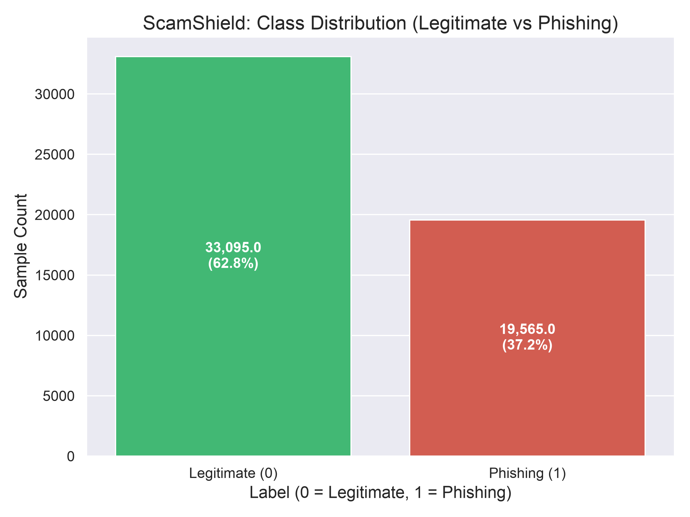
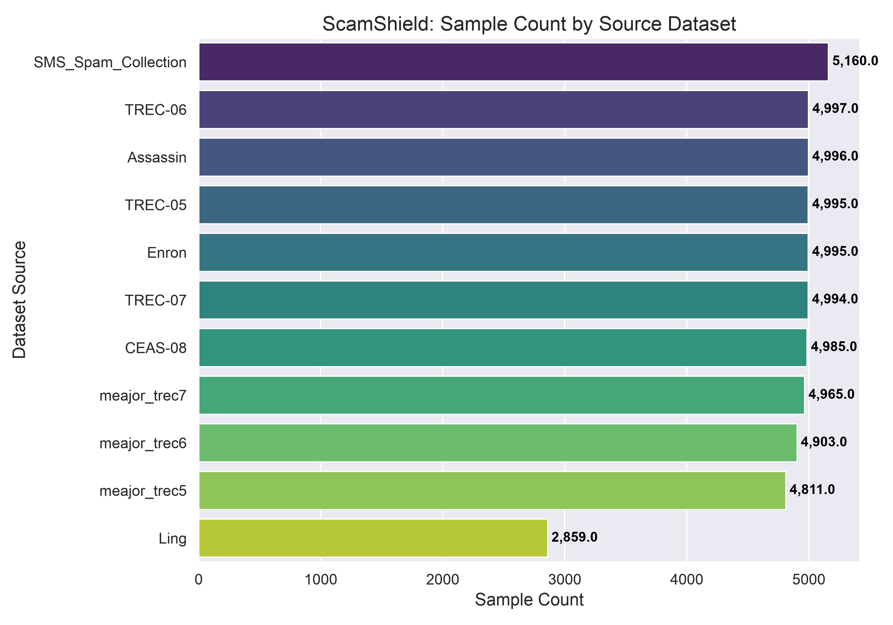
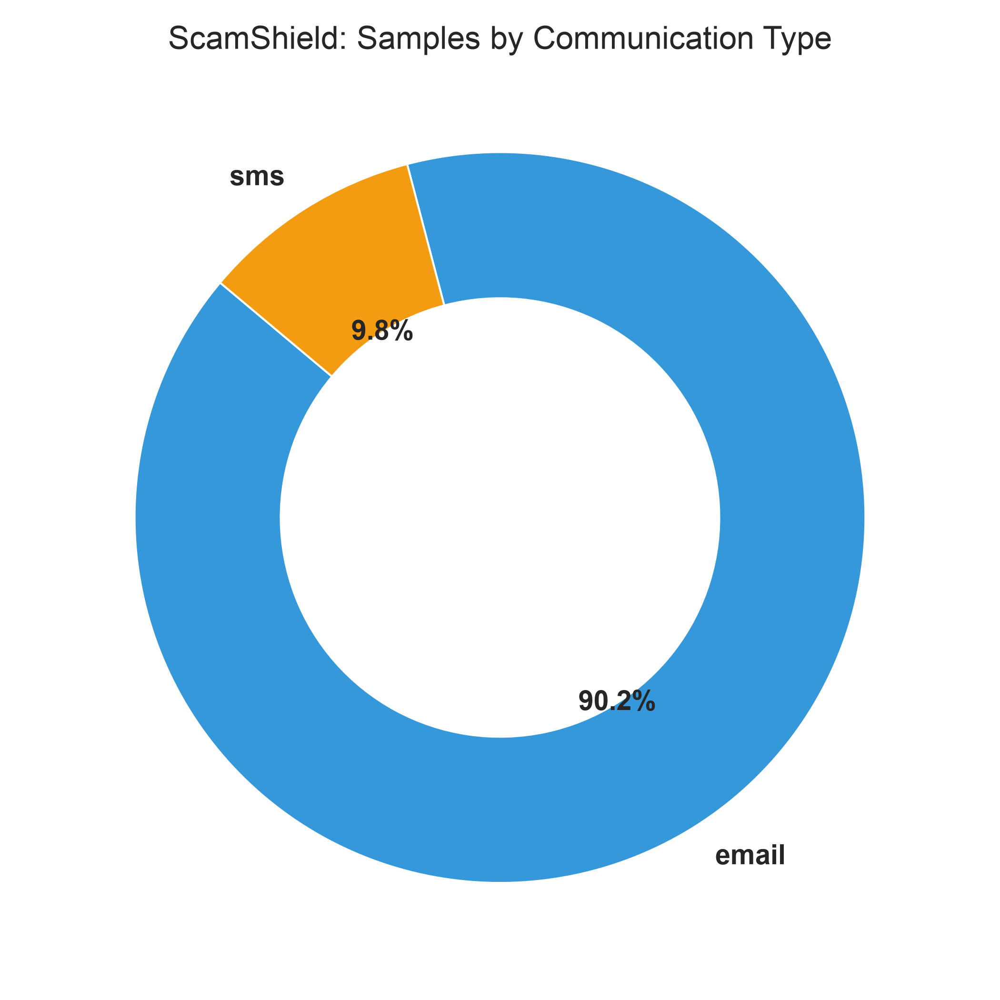
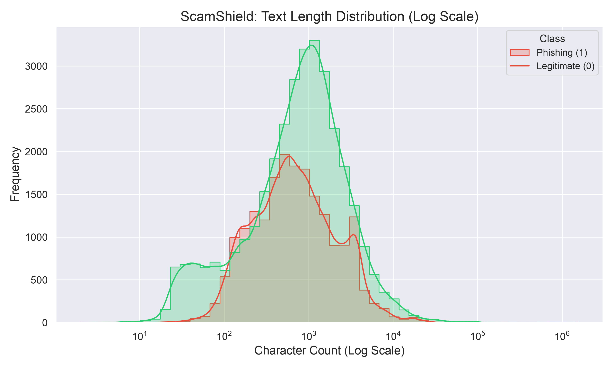

# ScamShield — Exploratory Data Analysis (EDA) Report

## Overview & Key Findings

* **Total Cleaned Samples:** 52,660
* **Legitimate Messages (0):** 33,095 (62.85%)
* **Phishing Messages (1):** 19,565 (37.15%)
* **Class Ratio (Legit : Phish):** ~1.69 : 1
* **Data Sources:** 11 distinct sources integrated.
* **Communication Types:** 47,500 Emails (90.2%), 5,160 SMS (9.8%).

---

## 1. Class Distribution

The dataset maintains a realistic class distribution reflecting real-world volumes where benign communications outnumber fraudulent ones, while providing sufficient positive samples for training.

---

## 2. Samples by Source Dataset

We have integrated 11 distinct dataset sources across TREC, Enron, CEAS-08, SpamAssassin, Ling, MeAJOR, and UCI SMS Spam collections to ensure wide linguistic variety.

---

## 3. Communication Type Distribution

The dataset includes both email communications and SMS text messages, establishing ScamShield as a multi-modal text scam detector.

---

## 4. Text Length Analysis

| Metric | Legitimate (0) | Phishing (1) | Overall |
|---|---|---|---|
| **Min Length** | 2 | 11 | 2 |
| **Max Length** | 1,542,928 | 230,906 | 1,542,928 |
| **Mean Length** | 1664.43 | 1337.67 | 1543.03 |
| **Median Length** | 835.0 | 641.0 | 761.0 |

* **Key Insight:** Phishing messages display distinct textual length characteristics. SMS messages are concise (under 200 characters), whereas email phishing messages often display specific length distributions depending on whether they are short credential harvests or longer advance-fee/social-engineering narratives.
