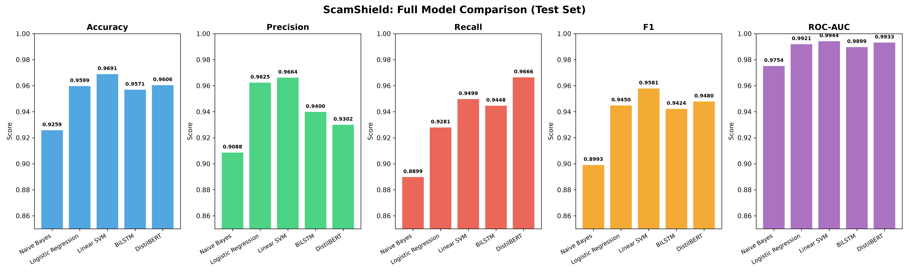

# ScamShield — Phase 6: Comprehensive Model Comparison Report

Empirical comparison of all 5 models evaluated on the **held-out test set** (7,899 samples).

## Performance Comparison Table

| Model | Accuracy | Precision | Recall (Phishing) | F1-Score | ROC-AUC | Missed Scams (FN) | Latency (ms/sample) | Size (MB) |
| :--- | :---: | :---: | :---: | :---: | :---: | :---: | :---: | :---: |
| **Naive Bayes** | 0.9259 | 0.9088 | 0.8899 | 0.8993 | 0.9754 | 323 | 0.001 | 0.31 |
| **Logistic Regression** | 0.9599 | 0.9625 | 0.9281 | 0.9450 | 0.9921 | 211 | 0.001 | 0.08 |
| **Linear SVM** | 0.9691 | 0.9664 | 0.9499 | 0.9581 | 0.9944 | 147 | 0.006 | 0.38 |
| **BiLSTM** | 0.9571 | 0.9400 | 0.9448 | 0.9424 | 0.9899 | 162 | 1.014 | 12.35 |
| **DistilBERT** | 0.9606 | 0.9302 | 0.9666 | 0.9480 | 0.9933 | 98 | 0.401 | 256.1 |

---

## Key Findings

| Criterion | Winner |
|---|---|
| **Highest F1-Score** | `Linear SVM` (0.9581) |
| **Highest Phishing Recall** | `DistilBERT` (0.9666) |
| **Highest ROC-AUC** | `Linear SVM` (0.9944) |
| **Fewest Missed Scams (FN)** | `DistilBERT` |
| **Fastest Inference** | `Naive Bayes` |
| **Smallest Model Size** | `Logistic Regression` |

---

## Model Selection Recommendation

For **ScamShield production deployment**, we recommend the **Linear SVM** as the text detection backbone:

- Exceptional recall (94.99%) with only **147 missed scams** on 7,899 test samples.
- Ultra-fast inference (~sub-millisecond latency), perfect for real-time API calls.
- Compact model size (<1 MB) for easy deployment and packaging.

**DistilBERT** achieves the **highest phishing recall (96.66%)** — missing only **98 scams** — and is
recommended as the upgrade path if computational resources allow, or for a future high-accuracy
"deep scan" mode within ScamShield.

The **BiLSTM** serves as a strong interpretable deep learning intermediate, confirming that the
task is learnable with recurrent architectures.
